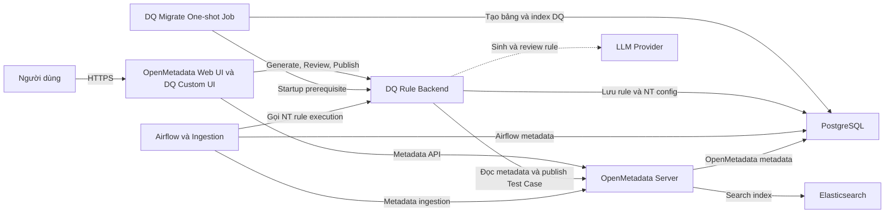

# BÁO CÁO ĐÁNH GIÁ GO-LIVE HỆ THỐNG DATA QUALITY

| Thuộc tính | Giá trị |
|---|---|
| Hệ thống | Data Quality Rule Recommender tích hợp OpenMetadata |
| Ngày đánh giá | 21/10/2026 |
| Phạm vi | DQ Backend, DQ Migration, OpenMetadata UI tùy chỉnh, PostgreSQL, Airflow/Ingestion, LLM Provider; go-live BASIC + ADVANCED, chưa gồm STATISTICAL |
| Cơ sở đánh giá | Source code và cấu hình trong repository `openmetadata-modify` |
| Trạng thái đề xuất | **NO-GO cho production public; CONDITIONAL GO cho UAT/internal** |

> Báo cáo này phản ánh trạng thái source code và cấu hình tại thời điểm đánh giá. Chưa có kết quả kiểm chứng trực tiếp trên database production hoặc hạ tầng Airflow/PostgreSQL của đơn vị triển khai.

## 1. Mục tiêu báo cáo

Báo cáo nhằm:

1. Mô tả kiến trúc triển khai của hệ thống DQ.
2. Xác định các hạng mục đã được xử lý.
3. Xác định các hạng mục chưa hoàn thiện hoặc chưa được kiểm chứng.
4. Đánh giá ảnh hưởng khi DQ backend, migration hoặc UI tùy chỉnh gặp lỗi.
5. Đưa ra điều kiện Go/No-Go, kế hoạch triển khai và rollback.
6. Làm cơ sở phối hợp giữa đội DQ, OpenMetadata, DBA, Airflow, AI và Security.

## 2. Phạm vi hệ thống

Các thành phần nằm trong phạm vi đánh giá:

- OpenMetadata Server và OpenMetadata Web UI.
- Trang DQ Rule Recommender tùy chỉnh trong OpenMetadata UI.
- DQ Rule Backend viết bằng FastAPI.
- `dq-migrate` one-shot container/job.
- PostgreSQL persistence cho DQ rule và NT rule configuration.
- Airflow/Ingestion và luồng gọi NT rule.
- LLM Provider cho Advanced rules.
- Luồng review và publish Test Case lên OpenMetadata.

Không nằm trong phạm vi xác nhận thực tế của báo cáo này:

- Statistical rule engine trong đợt go-live hiện tại. Source được giữ lại nhưng API mặc định không đăng ký và bulk job từ chối engine `STATISTICAL`.
- Cấu hình production thực tế của khách hàng.
- Quyền thật của PostgreSQL production user.
- Network/firewall production.
- Airflow deployment thực tế của khách hàng.
- Chính sách dữ liệu và hợp đồng với LLM Provider.
- Kết quả benchmark tải production.

## 3. Kiến trúc hệ thống



### 3.1 Nguyên tắc triển khai

- Các thành phần không cần chạy chung container.
- DQ backend và `dq-migrate` nên sử dụng cùng image version và cùng cấu hình database.
- `dq-migrate` chạy một lần rồi thoát.
- DQ backend chỉ khởi động sau khi migration thành công.
- Airflow, OpenMetadata và PostgreSQL có thể là hạ tầng có sẵn, miễn là endpoint và credential được cung cấp đúng.
- Không nên buộc khách hàng chạy lại PostgreSQL hoặc Airflow từ full Compose nếu họ đã có hạ tầng riêng.

### 3.2 Mô hình database khuyến nghị

Ưu tiên database riêng:

```text
PostgreSQL Server
├── openmetadata_db
├── airflow_db
└── dq_rules_db
```

Nếu bắt buộc dùng chung database, cần schema riêng:

```text
openmetadata_db
├── public.*    # OpenMetadata
└── dq.*        # DQ tables
```

Không khuyến nghị duy trì lâu dài mô hình hiện tại:

```text
openmetadata_db.public
├── OpenMetadata tables
├── dq_schema_migrations
├── dq_rules
└── nt_rule_configs
```

## 4. Cấu hình triển khai hiện tại

### 4.1 Cấu hình do đơn vị triển khai cung cấp

| Biến | Mục đích | Mặc định hiện tại |
|---|---|---|
| `DB_HOST` | PostgreSQL host | `postgresql` |
| `DB_PORT` | PostgreSQL port | `5432` |
| `OM_DATABASE` | Database mà DQ kết nối | `openmetadata_db` |
| `DB_USER` | PostgreSQL user | `openmetadata_user` |
| `DB_USER_PASSWORD` | PostgreSQL password | Bắt buộc |
| `DQ_DB_SSLMODE` | PostgreSQL SSL mode | `disable` |
| `DQ_DB_CONNECT_TIMEOUT` | Connection timeout | `10` giây |
| `DQ_OM_API` | OpenMetadata API endpoint | `http://openmetadata-server:8585` |
| `BOT_TOKEN` | OpenMetadata bot JWT | Tùy môi trường |
| `DQ_CORS_ORIGINS` | Browser origins được phép | Localhost mặc định |
| `DQ_API_PORT` | Port DQ API expose ra host | `8000` |

### 4.2 Thành phần đang hard-code

| Thành phần | Giá trị |
|---|---|
| Schema | Ngầm dùng PostgreSQL `search_path`, thường là `public` |
| Migration table | `dq_schema_migrations` |
| Rule table | `dq_rules` |
| NT configuration table | `nt_rule_configs` |
| Migration directory | `migrations/` |
| Initial migration | `001_create_rule_persistence.sql` |

Như vậy, user hiện có thể chọn server/database/credential, nhưng chưa thể chọn schema hoặc đổi tên bảng chỉ bằng cấu hình.

### 4.3 Cấu hình LLM và phạm vi engine trong Compose production

Compose đã truyền rõ các biến:

- `LLM_API`
- `LLM_BASE_URL`
- `LLM_MODEL`
- `LLM_TIMEOUT_SECONDS`
- `LLM_MAX_RETRIES`
- `ENABLE_ADVANCED_RULES=true`
- `ENABLE_STATISTICAL_RULES=false`

Production override bắt buộc khai báo API key, model và base URL cho Advanced. Secret phải được cấp qua secret manager hoặc cơ chế secret của nền tảng triển khai, không commit vào repository. Statistical chỉ được đưa lại vào scope sau khi có quyết định riêng và đổi `ENABLE_STATISTICAL_RULES=true`.

## 5. Các hạng mục đã xử lý

### 5.1 Isolation ở mức container/process

- DQ backend, DQ migration, OpenMetadata, Airflow, PostgreSQL và Elasticsearch là các service/container riêng.
- DQ backend crash không trực tiếp dừng OpenMetadata, Airflow hoặc PostgreSQL.
- DQ backend có chính sách `restart: always`.
- `depends_on` được dùng để kiểm soát thứ tự startup, không tạo phụ thuộc sống/chết runtime từ OpenMetadata sang DQ.

### 5.2 Migration và startup ordering

- Có `dq-migrate` one-shot container.
- DQ backend chỉ start khi `dq-migrate` hoàn thành thành công.
- Nếu migration fail, DQ backend không start trên schema chưa hoàn chỉnh.
- OpenMetadata và Airflow không phụ thuộc vào `dq-migrate` để tiếp tục hoạt động.

### 5.3 Migration hiện tại không destructive

Migration hiện tại:

- Không có `DROP TABLE`.
- Không có `DELETE`.
- Không có `TRUNCATE`.
- Không có `UPDATE` dữ liệu business.
- Chỉ tạo bảng, thêm cột, thay đổi kiểu `confidence` và tạo index.

Các bảng DQ được quản lý:

- `dq_schema_migrations`
- `dq_rules`
- `nt_rule_configs`

### 5.4 Transaction và khả năng chạy lại cơ bản

- Migration chạy trong PostgreSQL transaction.
- Nếu một statement lỗi, migration version không được ghi và transaction được rollback.
- Sử dụng `IF NOT EXISTS` cho table, column và index.
- Có bảng `dq_schema_migrations` để tránh chạy lại migration đã hoàn tất.

### 5.5 Health check

DQ backend có `/api/v1/health` để kiểm tra:

- Kết nối OpenMetadata.
- Kết nối PostgreSQL.

### 5.6 Guardrail cơ bản cho LLM và SQL

Đã có:

- Structured JSON output.
- Pydantic validation.
- Enum cho các advanced rule type.
- Confidence giới hạn trong khoảng `0–1` tại một số contract.
- Kiểm tra candidate column tồn tại.
- LLM sinh condition DSL thay vì sinh SQL trực tiếp theo luồng chuẩn.
- Backend compile DSL thành SQL.
- Identifier được validate và quote.
- Literal được bind/render thay vì nối chuỗi trực tiếp.
- Có bước SQL validation trước publish theo luồng `rule.sql` chuẩn.
- Generator lỗi có thể được ghi nhận là partial failure thay vì làm mất toàn bộ kết quả.

### 5.7 Test hiện có

Đã chạy unit test cho Advanced LLM, Statistical rules và SQL mapper:

```text
164 passed
```

Đã chạy nhóm test persistence/migration trong môi trường hiện tại:

```text
1 passed, 8 skipped
```

Các test PostgreSQL integration bị skip do chưa bật `DQ_TEST_POSTGRES=1` và chưa có PostgreSQL test tương ứng.

## 6. Các hạng mục chưa xử lý và hướng giải pháp

### 6.1 P0 — DQ API chưa có authentication và RBAC

**Hiện trạng**

- Các API generate, review, publish và update tier chưa có lớp authentication/authorization riêng.
- Port DQ API mặc định được expose ra host.
- Backend sử dụng `BOT_TOKEN` khi gọi OpenMetadata.

**Rủi ro**

- Người truy cập được port có thể gọi LLM, đọc metadata hoặc yêu cầu publish.
- Có thể phát sinh chi phí LLM và thay đổi OpenMetadata bằng quyền bot.

**Giải pháp**

1. Yêu cầu JWT cho toàn bộ endpoint, ngoại trừ health/readiness.
2. Validate JWT với OpenMetadata hoặc Identity Provider.
3. Áp dụng các quyền riêng: `DQ_VIEW`, `DQ_GENERATE`, `DQ_REVIEW`, `DQ_PUBLISH`, `DQ_ADMIN`.
4. Đặt DQ backend sau reverse proxy/API gateway.
5. Không expose port 8000 ra Internet.
6. Áp dụng rate limit theo user/service account.

### 6.2 P0 — Custom SQL publish còn đường bypass validation

**Hiện trạng**

- Publish endpoint cho phép client gửi nguyên `CandidateRule`.
- Client có thể tự đặt trạng thái `ACCEPTED` hoặc `EDITED`.
- SQL lấy từ `expression` hoặc `parameters.sqlExpression` có thể không đi qua cùng validator với `rule.sql`.

**Rủi ro**

- Có thể publish custom SQL chưa được review/validate lên OpenMetadata.
- Blast radius phụ thuộc quyền database của ingestion runner.

**Giải pháp**

1. Publish API chỉ nhận `rule_ids`.
2. Backend load rule từ PostgreSQL và xác nhận trạng thái review.
3. Không tin trạng thái hoặc SQL do browser gửi lên.
4. Chỉ sử dụng một trường SQL canonical.
5. Mọi custom SQL phải qua validator bất kể nguồn dữ liệu.
6. Dùng SQL AST parser thay cho regex thuần túy.
7. Enforce target table allowlist và read-only database role.
8. Thêm statement timeout cho query DQ.

### 6.3 P1 — Database/schema chưa được isolation

**Hiện trạng**

- DQ mặc định dùng `OM_DATABASE=openmetadata_db`.
- Schema thường là `public`.
- DQ có thể dùng cùng database user với OpenMetadata.

**Rủi ro**

- DQ dùng hết connection hoặc disk có thể ảnh hưởng OpenMetadata.
- Migration giữ lock trên bảng DQ trong cùng DB server.
- Sai sót migration tương lai có blast radius lớn.

**Giải pháp**

1. Ưu tiên database riêng `dq_rules_db`.
2. Nếu dùng chung DB, tạo schema riêng `dq`.
3. Tạo `dq_service` DB user chỉ có quyền trên DQ database/schema.
4. Thêm `DQ_POSTGRES_DB` và `DQ_POSTGRES_SCHEMA`.
5. Đặt connection pool limit và statement timeout.

### 6.4 P1 — Migration chưa có checksum và advisory lock

**Hiện trạng**

- Migration chỉ được nhận diện bằng tên file.
- Không có checksum để phát hiện file đã bị sửa.
- Không có lock ngăn hai deployment chạy migration đồng thời.
- Chưa có schema drift validation sau migration.

**Giải pháp**

1. Lưu SHA-256 checksum trong `dq_schema_migrations`.
2. Fail khi cùng version nhưng checksum khác.
3. Dùng PostgreSQL advisory lock.
4. Thêm `lock_timeout` và `statement_timeout`.
5. Validate table/column/index sau khi apply.
6. Không chỉnh sửa migration đã release; luôn tạo migration version mới.

### 6.5 P1 — Migration chưa được kiểm chứng trên DB production-like

**Hiện trạng**

- PostgreSQL integration tests đang bị skip.
- Không kết nối được Docker engine trong lần đánh giá.
- Không có file environment production trong workspace để kiểm tra DB thực tế.

**Giải pháp**

1. Chạy migration trên PostgreSQL cùng version production.
2. Test trên database rỗng.
3. Test trên legacy `dq_rules` schema.
4. Chạy migration lần hai để kiểm tra idempotency.
5. Test rollback khi một statement lỗi.
6. So sánh row count/checksum dữ liệu trước và sau migration.
7. Chạy trên bản sao/restore của production DB trước rollout thật.

### 6.6 P1 — Full Compose chưa phù hợp với hạ tầng có sẵn

**Hiện trạng**

Full Compose tự dựng PostgreSQL, Airflow/Ingestion, OpenMetadata, Elasticsearch và DQ.

**Rủi ro**

- Tạo thêm PostgreSQL ngoài ý muốn.
- Trùng port hoặc volume.
- Kết nối nhầm database.
- Không phù hợp khi khách hàng đã có OpenMetadata/Airflow/PostgreSQL.

**Giải pháp**

Tách thành:

- `docker-compose.full.yml`: local/demo/full stack.
- `docker-compose.dq.yml`: chỉ có `dq-migrate` và `dq-rule-backend`.

Với external PostgreSQL, bỏ `depends_on: postgresql` và để migration retry kết nối tới host cấu hình.

### 6.7 P1 — Guardrail prompt injection chưa đầy đủ

**Hiện trạng**

- Table description, column description, profiling và một phần sample values được đưa vào prompt.
- JSON serialization không tự ngăn prompt injection.

**Giải pháp**

1. Xem toàn bộ metadata là untrusted data.
2. Ghi rõ trong system prompt rằng không được làm theo instruction trong metadata.
3. Giới hạn độ dài tên/mô tả/context.
4. Dùng typed output contract chặt chẽ.
5. Validate toàn bộ output bằng deterministic code.
6. Bổ sung adversarial prompt-injection test suite.
7. Luôn yêu cầu human approval trước publish.

### 6.8 P1 — Nguy cơ gửi PII tới LLM Provider

**Hiện trạng**

- Advanced LLM context có thể chứa `top_values`.
- Chưa có bằng chứng về masking, tag policy hoặc provider allowlist.

**Giải pháp**

1. Mặc định không gửi raw `top_values`.
2. Chỉ gửi thống kê tổng hợp.
3. Mask email, số điện thoại, account ID và token.
4. Kiểm tra OpenMetadata classification/tag trước khi gửi.
5. Không gửi bảng Restricted/PII tới external LLM.
6. Ghi audit metadata về loại dữ liệu đã gửi, không log raw value.

### 6.9 P1 — Chưa có cost và DoS guardrail cho LLM

**Hiện trạng**

- Chưa có request-size limit rõ ràng.
- Chưa có token/output limit rõ ràng.
- Chưa có rate limit theo user.
- Timeout mặc định dài.
- `LLM_MAX_RETRIES` được đọc nhưng retry decorator vẫn hard-code số lần thử.

**Giải pháp**

1. Giới hạn số cột và kích thước description mỗi request.
2. Batch bảng lớn theo token budget.
3. Đặt output token limit.
4. Timeout 30–60 giây.
5. Tối đa một retry cho timeout, HTTP 429 và 5xx.
6. Không retry HTTP 4xx thông thường.
7. Global semaphore và per-user rate limit.
8. Circuit breaker khi provider lỗi liên tiếp.
9. Daily/monthly cost quota và alert.

### 6.10 P1 — Validation column reference chưa đầy đủ

**Hiện trạng**

- Một số TEMPORAL/CROSS_COLUMN condition chỉ kiểm tra field tồn tại.
- Chưa bảo đảm mọi column trong condition thuộc schema thật.

**Giải pháp**

1. Dùng discriminated Pydantic models cho từng condition type.
2. Thu thập toàn bộ referenced columns từ conditions.
3. So sánh với schema thật và candidate columns.
4. Kiểm tra datatype compatibility.
5. Giới hạn số condition, branch và IN-list values.
6. Chỉ đánh dấu rule `VALID` sau validation hoàn chỉnh.

### 6.11 P1 — Chưa xác nhận failure isolation của UI

**Hiện trạng**

- Chưa có bằng chứng kiểm thử rằng runtime exception trong DQ page không làm crash toàn OpenMetadata SPA.
- Chưa xác nhận behavior khi DQ backend offline hoặc timeout.

**Giải pháp**

1. Error Boundary riêng cho DQ route/page.
2. Lazy-load DQ modules.
3. Xử lý rõ 401, 403, 429, 500, 503 và timeout.
4. Hiển thị degraded state và retry thủ công.
5. Không auto-retry vô hạn.
6. Test UI khi backend DQ offline và response sai schema.

### 6.12 P1 — Tích hợp Airflow production chưa được xác nhận

**Hiện trạng**

Chưa xác định:

- Airflow deployment của khách hàng.
- Airflow database.
- Network route tới DQ backend.
- Cơ chế token giữa Airflow và DQ.
- DQ failure là blocking hay best-effort đối với ingestion.

**Giải pháp**

1. Chốt `DQ_NT_BACKEND_URL` và `DQ_NT_BACKEND_TOKEN`.
2. Đặt request timeout, polling interval và total timeout.
3. Quy định failure policy cho DAG.
4. Test NT execution end-to-end trên môi trường production-like.
5. Không yêu cầu Airflow chung container với DQ.

### 6.13 P2 — Observability chưa hoàn chỉnh

**Đã có:** health endpoint và application logs cơ bản.

**Còn thiếu/chưa xác nhận:**

- Structured JSON logs.
- Request/correlation ID.
- LLM latency, tokens và cost metrics.
- Migration duration và status metrics.
- DB pool/connection metrics.
- Publish success/failure metrics.
- Alert và dashboard.

**Giải pháp**

- Tích hợp Prometheus/OpenTelemetry.
- Mask credential và PII trong log.
- Thiết lập alert cho error rate, latency, LLM outage, DB connection exhaustion và publish failures.

## 7. Phân tích ảnh hưởng khi service lỗi

| Sự cố | Ảnh hưởng trực tiếp | Ảnh hưởng dây chuyền có thể có |
|---|---|---|
| DQ backend crash | Generate/review/publish/NT API không dùng được | Airflow task liên quan có thể timeout/fail |
| LLM Provider lỗi | Advanced generation lỗi | BASIC rules và OpenMetadata vẫn hoạt động |
| `dq-migrate` lỗi | DQ backend không start | OpenMetadata/Airflow/PostgreSQL vẫn có thể chạy |
| DQ UI component lỗi | DQ page/route có thể lỗi | Có thể ảnh hưởng toàn SPA nếu thiếu Error Boundary |
| PostgreSQL DQ quá tải | DQ persistence chậm/lỗi | Có thể ảnh hưởng OpenMetadata nếu dùng chung DB/server |
| DQ chiếm hết CPU/RAM host | DQ chậm hoặc OOM | Có thể làm toàn stack chậm nếu không có resource limit |
| Publish logic lỗi | Test Case sai hoặc dữ liệu rác | Tăng tải OpenMetadata hoặc ingestion |

### 7.1 Kết luận isolation

- Isolation ở mức container/process: **cơ bản đạt**.
- Isolation database: **chưa đạt đầy đủ**.
- Isolation frontend: **chưa được chứng minh bằng test**.
- Isolation tài nguyên: **chưa có bằng chứng về CPU/RAM/connection limits**.

## 8. Yêu cầu kiểm thử trước Go-live

### 8.1 Database và migration

- [ ] Backup production DB và xác nhận restore được.
- [ ] Chạy migration `--check`.
- [ ] Chạy migration trên DB rỗng.
- [ ] Chạy migration trên legacy schema.
- [ ] Chạy lại migration lần hai.
- [ ] Xác nhận không thay đổi bảng OpenMetadata.
- [ ] Kiểm tra row count dữ liệu DQ trước/sau.
- [ ] Kiểm tra duplicate fingerprint.
- [ ] Đo thời gian và lock khi alter/index.
- [ ] Test rollback khi SQL migration lỗi.

### 8.2 Backend/API

- [ ] Authentication test.
- [ ] RBAC test cho view/generate/review/publish/admin.
- [ ] Rate-limit test.
- [ ] Request-size limit test.
- [ ] Publish chỉ bằng stored rule ID.
- [ ] SQL validation bypass regression test.
- [ ] OpenMetadata API outage test.
- [ ] PostgreSQL outage test.
- [ ] Health/readiness behavior test.

### 8.3 LLM

- [ ] Prompt-injection test.
- [ ] Invalid JSON/output schema test.
- [ ] Hallucinated column test.
- [ ] PII masking test.
- [ ] Provider timeout/429/5xx test.
- [ ] Token and cost limit test.
- [ ] Large table/batching test.
- [ ] Human review bắt buộc trước publish.

### 8.4 UI

- [ ] DQ backend offline.
- [ ] API timeout.
- [ ] HTTP 401/403/429/500/503.
- [ ] Invalid response schema.
- [ ] Error Boundary không làm crash OpenMetadata shell.
- [ ] Retry không gây duplicate request/publish.

### 8.5 Airflow và end-to-end

- [ ] Airflow gọi được DQ backend qua network production.
- [ ] Token giữa Airflow và DQ hợp lệ.
- [ ] NT rule execution end-to-end.
- [ ] Xác nhận failure policy blocking/best-effort.
- [ ] Timeout không giữ worker quá lâu.
- [ ] Kết quả được publish đúng vào OpenMetadata.

## 9. Preflight database

### 9.1 Kiểm tra migration pending

```bash
docker compose --env-file <production-env> \
  -f docker/docker-compose.yml \
  run --rm --no-deps dq-migrate \
  python scripts/migrate_database.py --check
```

### 9.2 Kiểm tra DB/schema đích

```sql
SELECT current_database(), current_user, current_schema();
SHOW search_path;

SELECT table_name, column_name, data_type, is_nullable,
       numeric_precision, numeric_scale
FROM information_schema.columns
WHERE table_schema = 'public'
  AND table_name IN (
    'dq_rules',
    'dq_schema_migrations',
    'nt_rule_configs'
  )
ORDER BY table_name, ordinal_position;
```

### 9.3 Kiểm tra dữ liệu trước ALTER/INDEX

Chỉ chạy khi `dq_rules` đã tồn tại:

```sql
SELECT MIN(confidence), MAX(confidence),
       COUNT(*) FILTER (
         WHERE confidence IS NULL
            OR confidence < -9.9999
            OR confidence > 9.9999
       ) AS incompatible_rows
FROM public.dq_rules;

SELECT table_fqn, engine, rule_fingerprint, COUNT(*)
FROM public.dq_rules
WHERE table_fqn IS NOT NULL
  AND rule_fingerprint IS NOT NULL
GROUP BY table_fqn, engine, rule_fingerprint
HAVING COUNT(*) > 1;
```

## 10. Kế hoạch Go-live đề xuất

### Giai đoạn 1 — Chuẩn bị

1. Chốt topology OpenMetadata, Airflow và PostgreSQL production.
2. Chốt database/schema/user dành cho DQ.
3. Chốt LLM Provider, region và data policy.
4. Freeze source version và container image digest.
5. Cấu hình secret manager.
6. Hoàn thành các P0 blocker.

### Giai đoạn 2 — Preflight

1. Backup PostgreSQL.
2. Kiểm tra khả năng restore.
3. Chạy migration trên bản sao production DB.
4. Chạy security và integration test.
5. Xác nhận monitoring/dashboard/alert.
6. Nhận sign-off từ DBA, Security, OpenMetadata owner và Airflow owner.

### Giai đoạn 3 — Deployment

1. Chạy OpenMetadata migration nếu có.
2. Chạy `dq-migrate`.
3. Xác nhận migration version, table, column và index.
4. Khởi động DQ backend.
5. Kiểm tra health/readiness.
6. Kiểm tra OpenMetadata UI.
7. Generate một BASIC rule.
8. Generate một Advanced rule và xác nhận Statistical không xuất hiện trong API/UI go-live.
9. Review và publish một test rule được kiểm soát.
10. Chạy một NT flow qua Airflow.

### Giai đoạn 4 — Controlled rollout

1. Chỉ mở cho nhóm nội bộ.
2. Theo dõi error rate, latency, DB connection và LLM cost.
3. Mở dần cho nhóm user tiếp theo.
4. Chỉ mở public khi toàn bộ P0/P1 bắt buộc đã được sign-off.

## 11. Kế hoạch rollback

### 11.1 Khi DQ backend lỗi nhưng migration thành công

1. Dừng traffic tới DQ backend.
2. Rollback container image về version trước.
3. Giữ nguyên các bảng DQ vì migration hiện tại additive.
4. Không xóa bảng/cột tự động.
5. Kiểm tra compatibility của image cũ với schema mới.

### 11.2 Khi migration lỗi

1. Không khởi động DQ backend.
2. Thu thập migration logs.
3. Xác nhận transaction đã rollback.
4. Kiểm tra migration version không bị ghi sai.
5. Sửa bằng migration version mới; không chỉnh migration đã release.
6. Restore backup nếu phát hiện thay đổi ngoài dự kiến.

### 11.3 Khi publish sai Test Case

1. Dừng publish endpoint hoặc thu hồi quyền bot.
2. Xác định Test Case tạo trong khoảng sự cố.
3. Disable/delete theo change approval.
4. Sửa rule status và audit log.
5. Chạy regression test trước khi mở lại publish.

## 12. Ma trận Go/No-Go

| Hạng mục | Trạng thái | Mức độ | Điều kiện để GO |
|---|---|---|---|
| Container/process isolation | Đã có cơ bản | Đạt một phần | Thêm resource limits |
| Migration không destructive | Đạt theo static audit | Đạt | Chạy trên production-like DB |
| PostgreSQL integration test | Chưa chạy đầy đủ | Blocker | Toàn bộ test DB phải pass |
| Backup/restore rehearsal | Chưa có bằng chứng | Blocker | Restore test thành công |
| API authentication | Chưa có | P0 Blocker | JWT/auth middleware hoạt động |
| RBAC publish | Chưa có | P0 Blocker | Chỉ authorized reviewer/publisher |
| SQL publish validation | Có đường bypass | P0 Blocker | Đóng bypass và thêm regression test |
| DB/schema isolation | Chưa đầy đủ | P1 | DB/schema/user DQ riêng hoặc risk acceptance |
| LLM production config | Thiếu trong Compose | P1 Blocker nếu bật AI | Secret và provider config đầy đủ |
| PII policy cho LLM | Chưa có | P1 | Masking và classification policy |
| Prompt-injection tests | Chưa có | P1 | Adversarial suite pass |
| LLM rate/token limits | Chưa có | P1 | Limit và circuit breaker |
| UI Error Boundary | Chưa xác nhận | P1 | Failure-isolation test pass |
| Airflow production integration | Chưa xác nhận | Blocker | E2E NT flow pass |
| Monitoring/alerting | Chưa đầy đủ | P1 | Dashboard và alert hoạt động |

## 13. Quyết định đề xuất

### UAT/internal environment

**CONDITIONAL GO**, với điều kiện:

- DQ API chỉ truy cập được trong private network.
- Chưa cấp quyền publish production.
- Sử dụng test database hoặc schema riêng.
- LLM cost được giới hạn.
- Có người review thủ công toàn bộ rule.

### Production public

**NO-GO tại thời điểm đánh giá**, do còn các blocker:

1. DQ API chưa có authentication/RBAC.
2. Custom SQL publish còn đường bypass validation.
3. PostgreSQL migration integration test chưa chạy đầy đủ.
4. Chưa có bằng chứng backup/restore rehearsal.
5. Chưa xác nhận hạ tầng Airflow/PostgreSQL production.
6. Cấu hình và data policy cho LLM chưa hoàn chỉnh.

Production chỉ được chuyển sang GO sau khi tất cả P0 được đóng, các P1 bắt buộc có owner/deadline hoặc risk acceptance chính thức, và checklist Go-live được ký duyệt.

## 14. Phân công trách nhiệm đề xuất

| Hạng mục | Owner đề xuất |
|---|---|
| DQ backend và migration | DQ Backend Team |
| OpenMetadata UI và Error Boundary | Frontend/OpenMetadata Team |
| PostgreSQL DB/schema/backup | DBA/Platform Team |
| Airflow connectivity và DAG policy | Data Platform/Airflow Team |
| Authentication, RBAC, secret | Security/Identity Team |
| LLM provider, cost, data policy | AI Platform và Data Governance |
| Monitoring, alert, deployment | DevOps/SRE |
| Business rule acceptance | Data Owner/Data Steward |

## 15. Sign-off

| Vai trò | Người phê duyệt | Quyết định | Ngày | Ghi chú |
|---|---|---|---|---|
| DQ Technical Owner |  |  |  |  |
| OpenMetadata Owner |  |  |  |  |
| DBA |  |  |  |  |
| Airflow/Data Platform Owner |  |  |  |  |
| Security |  |  |  |  |
| SRE/Operations |  |  |  |  |
| Business/Data Owner |  |  |  |  |

---

## Phụ lục A — Tài liệu/source đã kiểm tra

- `docker/docker-compose.yml`
- `docker/docker-compose-dq.override.yml`
- `dq-rule-recommender-openmetadata/Dockerfile`
- `dq-rule-recommender-openmetadata/scripts/migrate_database.py`
- `dq-rule-recommender-openmetadata/migrations/001_create_rule_persistence.sql`
- `dq-rule-recommender-openmetadata/backend/storage/migration_runner.py`
- `dq-rule-recommender-openmetadata/backend/storage/db_service.py`
- `dq-rule-recommender-openmetadata/backend/main.py`
- `dq-rule-recommender-openmetadata/backend/engine/advanced_llm/*`
- `dq-rule-recommender-openmetadata/backend/engine/sql_mapper/*`
- `dq-rule-recommender-openmetadata/backend/integrations/openmetadata_publisher.py`
- Các test Advanced, Statistical, SQL Mapper và PostgreSQL persistence liên quan.

## Phụ lục B — Bằng chứng test tại thời điểm đánh giá

```text
Advanced LLM + Statistical + SQL Mapper:
164 passed

PostgreSQL persistence/migration subset:
1 passed, 8 skipped

Lý do skip:
DQ_TEST_POSTGRES=1 chưa được bật và chưa có PostgreSQL test phù hợp trong môi trường đánh giá.
```
